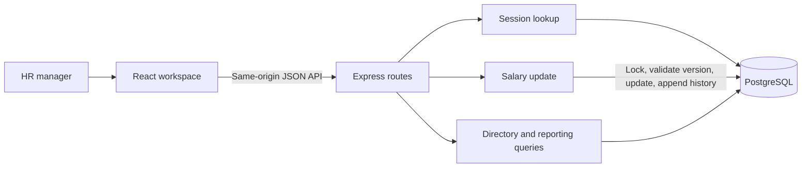

# Design notes

## Architecture

The production build serves React and the API from one Node process. Docker Compose runs that image next to PostgreSQL 17. The React drawer uses Radix Dialog for keyboard navigation, focus management, and announcements. User inputs cross the boundary through a small shared contract and server-side validation.

## Data and API

| Endpoint | Purpose |
| --- | --- |
| `GET /api/health` | Check application access to the database. |
| `POST /api/auth/login`, `GET /api/auth/me`, `POST /api/auth/logout` | Start, inspect, or revoke the HR session. |
| `GET /api/filters` | Return country and department choices. |
| `GET /api/employees?q=&country=&department=&page=` | Search and page through employees. Optional filters combine with AND. |
| `GET /api/employees/:id` | Return salary, version, and most recent changes first. |
| `PATCH /api/employees/:id/salary` | Save `salaryMinor`, `version`, and `reason` for the signed-in actor. |
| `GET /api/compensation?country=&department=` | Return headcount, total, and median by currency and by country, department, and currency. |

`employees` stores current pay and a version counter. `salary_changes` stores the previous amount, new amount, currency, actor, reason, and database timestamp. An update locks just the employee row, compares the version supplied by the UI, then writes the current amount and history in one transaction. A stale editor gets a 409 and can reload the latest salary while keeping their proposed value and reason for review. A matching salary produces a validation error and no history entry.

## Money and reporting

The seeded currencies use two decimal places. The browser converts the decimal string to minor units by splitting the digits, and PostgreSQL stores `bigint` values. Annual base salary is capped at 1 billion major units per employee. Under the 10,000-employee scope, individual values and group totals fit within JavaScript’s safe integer range. SQL calculates each median from its own currency group and rounds a half minor unit up. The meaning of a financial total follows its displayed currency and visible filters. The current report queries operational data, so a saved update is visible on the next fetch.

## Session and data handling

Passwords use salted scrypt hashes. Session tokens are random, stored hashed in PostgreSQL, and expire after eight hours. The browser receives an HTTP-only SameSite cookie, marked Secure for an HTTPS deployment. The API rejects browser writes from another origin and requires JSON for state-changing requests. Sign-in attempts are bounded per client IP. A local shared demo account is convenient for synthetic data. Real HR deployment would need enterprise identity, per-user permissions, audit retention controls, secret rotation, and monitoring.

## Scale and trade-offs

The directory returns 20 rows with stable employee ID ordering. Filters and aggregation run on the server. Unique employee codes and indexes support lookups and bounded result ordering. Substring matching and percentile sorting are affordable on this seeded dataset. If volume increases, measure substring latency before adding a trigram index, and consider keyset pagination for deeper pages. Consider a reporting projection only when measured read load warrants the added freshness and reconciliation decisions.

Deployment stays a single app plus PostgreSQL. Database setup is idempotent for this initial schema and seeds only an empty employee table. A future schema change would use a numbered migration and be tested independently of seed setup.
